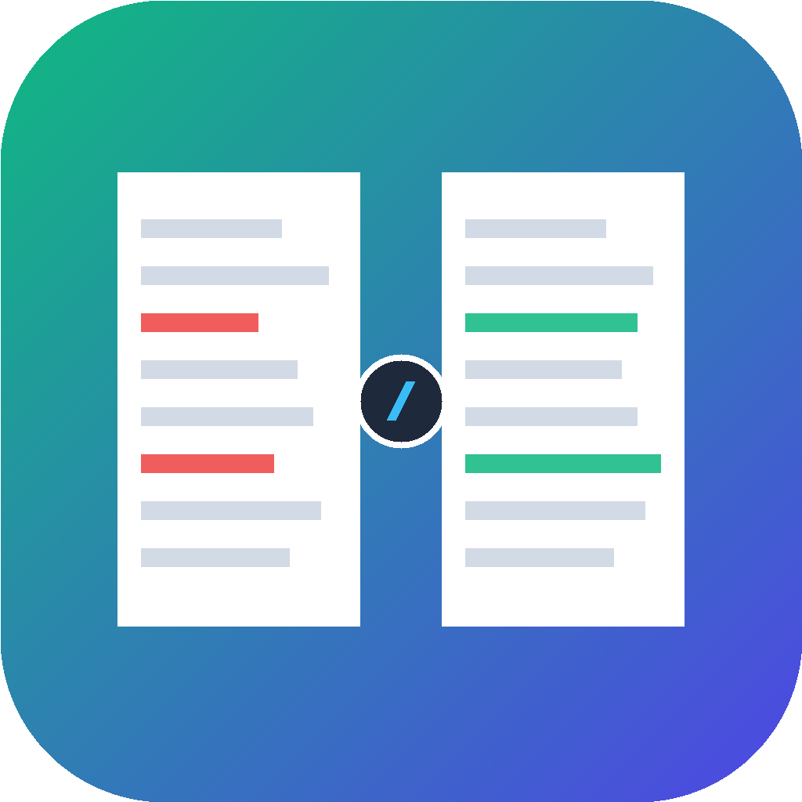

<div align="center">



# ⚡ DiffChecker Pro

**下一代全功能纯净代码与多格式文件对比工具 · 内置深度 AI 架构全流程审计**

[](https://github.com/rabby-weex/diffchecker-pro/releases)
[](https://github.com/rabby-weex/diffchecker-pro)
[-f59e0b?style=flat-square&logo=python)](https://github.com/rabby-weex/diffchecker-pro)
[](./LICENSE)
[](https://github.com/rabby-weex/diffchecker-pro)

[English](./INSTALL.md#🌐-offline-and-source-execution) | [简体中文](#-快速安装) | [详细安装指南 (INSTALL.md)](./INSTALL.md)

</div>

---

## 💡 为什么选择 DiffChecker Pro？

日常开发中，传统的网页对比工具（如 Diffchecker.com 等）充斥着大量牛皮癣广告、网络卡顿，且将敏感企业代码上传至公网服务器存在巨大的数据泄露风险。

**DiffChecker Pro** 是专为工程师与审计人员打造的现代化本地应用：
* 🚀 **100% 纯净无广告**：彻底移除所有横幅与弹窗，界面极致干净、沉浸专注；
* 🔒 **本地私密运行**：所有对比逻辑纯在本地浏览器运行，源码绝不外泄；
* 🤖 **深度 AI 步骤审计**：一键生成全流程步骤拆解（第 1 步到第 N 步工作内容）、数据库连接与配置、环境变量明细；
* 📦 **自包含零依赖**：基于原生 Python 3 标准库打造，**免装任何第三方 pip 模块**，开箱即用；
* 🖥️ **跨平台原生体验**：提供标准的 macOS DMG / .app 以及 Windows 一键快捷方式与静默无黑框后台模式。

---

## 📥 快速下载与安装

详细跨电脑安装教程请查阅 👉 [**INSTALL.md (本地安装与部署完整指南)**](./INSTALL.md)

| 操作系统 | 推荐安装包 | 安装方式 | 运行说明 |
| :--- | :--- | :--- | :--- |
| **macOS** (Intel / Apple Silicon) | [**DiffCheckerPro-macOS-v1.0.0.dmg**](https://github.com/rabby-weex/diffchecker-pro/releases/download/v1.0.0/DiffCheckerPro-macOS-v1.0.0.dmg) | 双击打开 DMG，拖拽至 `Applications` | 开箱即用，原生 Dock 图标 |
| **macOS** (绿色压缩包) | [**DiffCheckerPro-macOS-v1.0.0.zip**](https://github.com/rabby-weex/diffchecker-pro/releases/download/v1.0.0/DiffCheckerPro-macOS-v1.0.0.zip) | 解压后双击 `DiffChecker Pro.app` | 便携免安装 |
| **Windows** (10 / 11 / Server) | [**DiffCheckerPro-Windows-v1.0.0.zip**](https://github.com/rabby-weex/diffchecker-pro/releases/download/v1.0.0/DiffCheckerPro-Windows-v1.0.0.zip) | 解压后运行 `install.bat` | 自动生成桌面快捷方式，支持 `DiffCheckerPro.vbs` 静默启动 |

> 提示：运行本工具仅需目标电脑具备标准 Python 3.7+ 环境（macOS 自带或通过官方安装；Windows 安装时请勾选 `Add Python to PATH`）。

---

## ✨ 核心特性

### 1. ⚡ 毫秒级多语言代码与文本对比
* **双栏对比 (Side-by-Side)** 与 **单栏统一对比 (Unified Diff)** 随心切换；
* 字符级 (Character-level) 差异精确标亮；
* 智能代码折叠与未变动行过滤，滚动字幕同步对齐；
* 支持从剪贴板一键置入代码、差异结果快速导出为 Diff 补丁文件。

### 2. 🤖 深度 AI 架构与代码全流程审计
在顶部点击 **「🤖 AI 分析」**，体验大模型驱动的自动化代码审查：
* **自由切换分析对象**：支持在弹窗下拉框中灵活选择「原始代码 (Original)」、「修改后代码 (Changed)」、「差异补丁 (Diff)」或「PDF 页面」；
* **分步工作流程全览**：精准拆解代码的第一步做了什么、第二步做了什么...直到后续所有步骤的具体工作内容；
* **数据持久层识别**：自动探测涉及的数据库类型（MySQL / Redis / MongoDB / Postgres / Doris 等）、表名、连接方式与配置要点；
* **环境依赖剖析**：全面解析依赖的环境变量名称、配置默认值与安全注入说明；
* **多模型生态**：全面接入 Claude 3.7 / 3.5 Sonnet / Haiku / Opus、OpenAI GPT-4o / Codex、DeepSeek V3 / V4 Flash / Pro 等前沿大模型。

### 3. 🖼️ 多模式图像差异对比
* **左右分屏模式**：双图并排缩放查看；
* **交互滑块透视模式 (Slider Swipe)**：拖动中间滑杆实时透视前后改动，微小像素级位移一览无余；
* **像素融合差异模式 (Difference Blend)**：自动标亮发生颜色与轮廓变动的局部区域。

### 4. 📄 PDF 页面与格式排版对比
* 支持多页 PDF 渲染与分页对齐对比；
* 快速识别合同、规范文档中的条款修改、段落增删与文字替换。

### 5. 📁 目录树与工程结构对比
* 支持对比两份本地工程文件夹；
* 深度扫描文件层级，直观标明「新增文件」、「删除文件」与「修改文件」；
* 点击目录树中任意变动文件可直接穿透进入代码级比对。

### 6. 📊 Excel 与 CSV 单元格级比对
* 支持 `.xlsx`、`.xls`、`.csv` 等表格；
* 逐行逐列匹配，精确定位被修改数值的单元格并高亮背景。

---

## 🛠️ 本地源码与开发运行

如需在本地进行二次开发或直接以开发者模式启动：

```bash
# 1. 克隆代码仓库
git clone https://github.com/rabby-weex/diffchecker-pro.git
cd diffchecker-pro

# 2. 启动本地服务 (纯标准库，无需 pip install)
python3 server.py

# 3. 浏览器会自动弹出或访问
http://127.0.0.1:28833/
```

### 快捷键支持

| 快捷键 (macOS / Windows) | 功能说明 |
| :--- | :--- |
| `Ctrl / Cmd + Enter` | 立即执行当前对比 |
| `Ctrl / Cmd + Shift + F` | 切换全屏沉浸模式 |
| `Ctrl / Cmd + Shift + D` | 切换深色 / 浅色模式 |
| `Ctrl / Cmd + Shift + A` | 快速唤起 AI 全流程分析弹窗 |

---

## 🔒 隐私与安全声明

* **本地私有计算**：所有的文本比对、图像像素计算、PDF 解析均在本地浏览器内完成；
* **代理安全隔离**：`server.py` 仅作为本地静态托管及受信任 AI 网关的安全中继（防止浏览器跨域 CORS 拦截），绝不对外上传或存储用户比对数据；
* **可配置网关**：点击应用右上角「⚙️ 接入信息」即可自由配置企业自建大模型网关或 OpenAI 兼容 API 地址与私有 Key。

---

## 📄 开源许可证

本项目基于 [MIT License](./LICENSE) 协议开源。欢迎提交 Issue 与 Pull Request！
